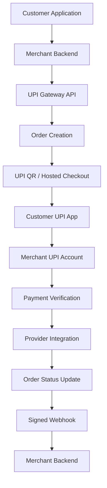

#  UPI Gateway

<h3 align="center">A Multi-Merchant UPI Payment Gateway</h3>

<p align="center">
  A self-hosted payment infrastructure for Indian merchants, featuring dynamic UPI QR codes, payment verification, account rotation, and secure webhook notifications.
</p>

<p align="center">
  
  
  
  
</p>

<p align="center">
  <a href="#-features">Features</a> ·
  <a href="#-screenshots">Screenshots</a> ·
  <a href="#-architecture">Architecture</a> ·
  <a href="#-installation">Installation</a> ·
  <a href="#-api-reference">API Reference</a>
</p>

---

<p align="center">
  
</p>

<p align="center">
  <b>UPI ID:</b> 6388401024@digikhata
</p>

<p align="center">
  <a href="upi://pay?pa=6388401024@digikhata&cu=INR">
    ❤️ Support via UPI
  </a>
</p>

---

##  Quick Installation

UPI Gateway includes a browser-based installer. For a hosting-server installation, use the prepared production package: it includes the production `vendor/` dependencies and compiled frontend assets, so **SSH, Composer, Node.js, and npm are not required on the hosting server**.

### 1. Download the production package

| Package | Download |
|---|---|
| **Recommended — Production ZIP** | [Download `upi-gateway-production.zip`](https://github.com/mynkdev-21/upi-gateway/releases/download/latest-main/upi-gateway-production.zip) |
| GitHub source archive | [Download `main.zip`](https://github.com/mynkdev-21/upi-gateway/archive/refs/heads/main.zip) |

The production ZIP is the preferred choice for installation. You can verify it with the accompanying [SHA-256 checksum](https://github.com/mynkdev-21/upi-gateway/releases/download/latest-main/upi-gateway-production.zip.sha256).

### 2. Prepare your hosting

- Use PHP 8.2 or newer and enable the required PHP extensions listed in the [Installation Guide](docs/INSTALLATION.md).
- Create a **MySQL** database and database user, and grant that user the required privileges.
- Enable HTTPS.
- Extract the application files outside the public web root where your hosting setup allows it.
- Set the website's **Document Root / Running Directory** to the application's `public/` directory. The public web root must expose only this directory—not the Laravel project root.

**Important:** Main-domain, subdomain, and subdirectory deployments depend on what your hosting panel and web server support. For cPanel, aaPanel/Nginx, and subdirectory-specific instructions, follow the relevant deployment guide before changing the document root or web-server configuration. Do not replace an existing site's Nginx/Apache configuration blindly.

### 3. Run the browser installer

Open your website over HTTPS and visit:

```text
https://yourdomain.com/install
```

Follow the wizard:

1. **Requirements check** — resolve any failed PHP, extension, permission, or hosting checks.
2. **Database setup** — enter the MySQL database details and test the connection.
3. **Migrations** — let the installer create the application tables.
4. **Admin account** — create your administrator login.

After installation, sign in to the admin dashboard. The installer is locked after successful setup; do not bypass or remove the installation protection.

### Installation guides

| Guide | What it covers |
|---|---|
| [Installation Wizard](docs/INSTALLATION.md) | Requirements, installer screens, database setup, and troubleshooting |
| [cPanel](docs/CPANEL.md) | Shared hosting, database creation, file placement, cron jobs, and production package |
| [Ubuntu VPS](docs/VPS.md) | Ubuntu, Nginx, PHP-FPM, MySQL, SSL, queue worker, and scheduler |

> [!WARNING]
> Do not accept live payments until you have checked the production security checklist, configured queue/scheduler tasks, and completed your own payment-provider and hosting tests. Local automated tests do not prove compatibility with every hosting provider or UPI app.

### Free installation support

Need help? We provide free installation guidance for UPI Gateway users.

- **[WhatsApp Installation Support](https://wa.me/916388401024)**
- **[Open a GitHub issue](https://github.com/mynkdev-21/upi-gateway/issues)**

When asking for help, share your hosting provider, PHP version, deployment type (main domain, subdomain, or subdirectory), and a screenshot of the error.

**Never share hosting/SSH passwords, database passwords, API secrets, or your `.env` file.**

---

##  Live Demo

Explore the UPI Gateway application through our live demo:

**Live Demo:** [https://appnk.site/](https://appnk.site/)

**Demo Login Credentials:**

- Email: `demo@test.com`
- Password: `demo@test.com`

**Demo Mode — Read Only**

The demo environment allows visitors to log in and explore the application, including the dashboard, orders, accounts and available modules.

For security reasons, all data modification operations are disabled for demo users. Creating, editing, deleting, submitting orders and initiating payments are not permitted.

The demo account has restricted merchant-level access and cannot access administrative functions or API credentials.

---

##  Release Status

**v1.1.0 is currently a stable release candidate; a v1.1.0 Git tag and GitHub Release have not been published.** The rolling production package is published at the download link above.

The project includes the browser installer, MySQL production configuration, payment-verification integrations, timestamped webhook signatures, and hosting guides. External verification is still required for each target hosting environment, cron behavior under production conditions, and real-device payment flows with GPay, PhonePe, Paytm, and BHIM. Review the deployment guides and complete your own environment-specific testing before accepting live payments.

[](https://github.com/mynkdev-21/upi-gateway/actions/workflows/build-package.yml)

---

##  Overview

UPI Gateway is a self-hosted, multi-merchant payment management platform designed for businesses that want to integrate UPI payments into their applications.

Each merchant can configure their own UPI accounts, generate dynamic payment QR codes, track transactions, and receive automated payment notifications.

**Payments are intended to go directly to the configured merchant UPI accounts. The platform is not designed to hold or pool merchant funds.**

### Key Capabilities

- Multi-merchant account management
- Dynamic UPI QR generation and hosted checkout
- Automated payment verification integrations
- Multiple UPI account rotation and daily limits
- Separate Live and Sandbox environments
- Timestamped HMAC-SHA256 webhook signatures with a five-minute validation window
- Separate encrypted Live and Sandbox webhook signing secrets
- Webhook event IDs and sequence numbers for merchant-side deduplication and ordering
- Manual UTR verification and review flow
- Merchant API authentication
- Centralized administration dashboard
- Browser-based installation wizard for cPanel and VPS deployments

---

##  Screenshots

### Homepage
<p align="center">
  
</p>

### Features
<p align="center">
  
</p>

### API Documentation
<p align="center">
  
</p>

### Admin Dashboard
<p align="center">
  
</p>

### Payment Account Management
<p align="center">
  
</p>

### Customer Payment Experience

<table>
  <tr>
    <td width="50%">
      <p align="center"><b>Payment Page</b></p>
      
    </td>
    <td width="50%">
      <p align="center"><b>Payment Verification</b></p>
      
    </td>
  </tr>
  <tr>
    <td colspan="2">
      <p align="center"><b>Payment Success</b></p>
      
    </td>
  </tr>
</table>

---

##  Features

###  Multi-Merchant Management
- Independent merchant accounts.
- Merchant-specific API credentials.
- Individual UPI payment account configuration.
- Centralized administration and monitoring.

###  Dynamic UPI Payments
- Dynamic UPI payment QR generation.
- Unique transaction reference for every order.
- Hosted checkout and payment pages.
- UPI intent integration.

###  Payment Verification
- Paytm for Business verification integration.
- Paytm Payment Gateway integration.
- PhonePe Payment Gateway integration.
- Manual UTR verification and review fallback.

###  UPI Account Rotation
- Configure multiple UPI accounts.
- Distribute payment requests across configured accounts for operational load balancing and redundancy.
- Account-level daily limits with automatic rollover to available accounts.
- Strict validation when `payment_account_id` is explicitly requested (never silently falls back to another account).
- Rotation is intended for legitimate load distribution across registered business accounts and must not be used to bypass bank-imposed velocity caps or regulatory limits.

### 🧪 Live & Sandbox Environments
- Separate Live and Sandbox credentials.
- Isolated test and live transactions.
- Sandbox transactions do not represent real payments.

### 🔔 Webhook Notifications
- Timestamped HMAC-SHA256 request signatures (`t=...,v1=...`) with a five-minute default tolerance.
- Separate encrypted Live and Sandbox webhook signing secrets.
- `order.paid` and `order.expired` events, plus supported review and Sandbox events.
- Durable webhook outbox, delivery logs, and queue retry handling.
- At-least-once delivery with event IDs and sequence numbers for merchant-side idempotency and ordering.

###  Security & Administration
- API key and secret authentication.
- Merchant isolation.
- Transaction monitoring.
- Admin dashboard.
- Payment verification history.
- Installation lock after successful setup.

---

##  System Architecture



### Payment Lifecycle

1. Merchant creates a payment order through the API.
2. Gateway generates a unique order reference and payment URL.
3. Customer scans the QR code or opens a UPI intent.
4. Customer completes the payment using their UPI application.
5. Gateway checks payment status through the configured verification integration.
6. Order status is updated after successful verification.
7. Merchant receives a signed webhook notification.

---

##  Technology Stack

<p align="center">
  
</p>

| Component | Technology |
|---|---|
| Backend Framework | Laravel 12 |
| Programming Language | PHP 8.2+ |
| Database | MySQL driver with MySQL 8.x or MariaDB 10.x/11.x (mandatory in production) |
| Frontend | Blade / JavaScript |
| Queue Processing | Laravel Queue |
| API Authentication | API Key & Secret |
| Webhook Security | HMAC-SHA256 |
| Web Server | Nginx / Apache-compatible PHP hosting |
| Build Tools | Composer, Node.js, NPM |

---

##  Installation

Install UPI Gateway using the browser-based wizard included in the prepared production package. The hosting server does not need SSH, Composer, Node.js, or npm.

### Server requirements

- PHP 8.2 or newer.
- MySQL or a supported MariaDB server through Laravel's MySQL driver. MySQL is required for installation and production; SQLite is used only by automated tests.
- PDO and PDO MySQL.
- Required Laravel extensions, including cURL, OpenSSL, Mbstring, Tokenizer, XML, JSON, and Fileinfo.
- HTTPS for production.
- Writable Laravel runtime directories with appropriately restricted permissions.
- A production package containing `vendor/` and compiled assets in `public/build/`.

### Installation steps

1. **Download:** Use the [production ZIP](https://github.com/mynkdev-21/upi-gateway/releases/download/latest-main/upi-gateway-production.zip). The [SHA-256 checksum](https://github.com/mynkdev-21/upi-gateway/releases/download/latest-main/upi-gateway-production.zip.sha256) is provided for integrity verification.
2. **Prepare the database:** Create a MySQL database and user, then grant the user the required privileges. In cPanel, use **MySQL Database Wizard** or **MySQL Databases**. Save the full database name, username, and password; cPanel may prepend your account name.
3. **Upload and extract:** Upload the ZIP using your hosting File Manager and extract it into the application directory described in your hosting guide.
4. **Configure the public directory:** Set the website's Document Root / Running Directory to the application's `public/` directory. Keep the Laravel project files outside the public web root. For subdirectory deployments or Nginx, follow the relevant guide; panel settings and web-server rules differ by host.
5. **Open the installer:** Visit `https://yourdomain.com/install` over HTTPS.
6. **Complete the wizard:** Pass the requirements check, enter and test the MySQL connection, run migrations, and create the administrator account.
7. **Finish securely:** Sign in to the dashboard and leave the installer protection enabled.

### Hosting-specific instructions

- [cPanel shared hosting](docs/CPANEL.md) — file placement, MySQL setup, document root, cron jobs, and queue processing.
- [Ubuntu VPS](docs/VPS.md) — Nginx, PHP-FPM, MySQL, SSL, queue worker, and scheduler.
- [Detailed installer guide](docs/INSTALLATION.md) — wizard screens, requirements, and troubleshooting.

**Document-root warning:** The website must serve the application's `public/` directory, not the project root. If the installer reports an incorrect document root, update the website's Running Directory / Document Root in your hosting panel and refresh the installer. Do not expose `.env`, application source, `vendor/`, or private storage files through HTTP.

**Subdirectory warning:** A URL such as `https://example.com/payments/` needs web-server routing that maps that URL prefix to the application's `public/` directory. `.htaccess` rules do not apply to Nginx. Follow the hosting guide and do not overwrite the existing main website's configuration.

### Need installation help?

We provide free installation guidance:

- **[WhatsApp Installation Support](https://wa.me/916388401024)**
- **[GitHub Issues](https://github.com/mynkdev-21/upi-gateway/issues)**

When contacting support, include your hosting provider, PHP version, deployment type (main domain, subdomain, or subdirectory), and a screenshot of the issue. **Never send passwords, API secrets, SSH credentials, or `.env` files.**

---

##  Environment Configuration

For command-line or development deployments, configure the following variables in your `.env` file. The browser installer configures the application during guided installation.

| Variable | Description | Example |
|---|---|---|
| `APP_NAME` | Application name | UPI Gateway |
| `APP_ENV` | Application environment | production |
| `APP_DEBUG` | Debug mode | false |
| `ALLOW_REGISTRATION` | Public merchant signup; disabled by default. | false |
| `APP_URL` | Application URL | https://example.com |
| `DB_CONNECTION` | Database driver | mysql |
| `DB_HOST` | Database host | 127.0.0.1 |
| `DB_DATABASE` | Database name | upi_gateway |
| `DB_USERNAME` | Database username | db_user |
| `DB_PASSWORD` | Database password | Strong password |
| `QUEUE_CONNECTION` | Queue driver | database |
| `SESSION_DRIVER` | Session driver | database |
| `SESSION_ENCRYPT` | Encrypt session payloads at rest in database | true |
| `APP_PREVIOUS_KEYS` | Comma-separated previous keys for zero-downtime key rotation | base64:... |

Never commit production credentials or API secrets to GitHub.

### Session Encryption at Rest & Key Management

- **Encrypted Session Payloads (`SESSION_ENCRYPT=true`):** New installations set `SESSION_ENCRYPT=true` in `.env.example`. When enabled, session data written to the database `sessions` table is encrypted with AES-256-CBC using `APP_KEY`. This ensures database administrators, storage backups, or query logs cannot read session attributes, CSRF tokens, or authentication states.
- **Toggling Encryption on Existing Deployments:** Enabling `SESSION_ENCRYPT=true` on an existing deployment where sessions were previously stored in plaintext invalidates active sessions on their next HTTP request. Laravel catches decryption failures gracefully without throwing an HTTP 500 error, clearing the unencrypted session so users simply log in again.
- **Cluster Node Consistency:** If deploying across multiple web servers behind a load balancer, all nodes must share the exact same `APP_KEY` (and `APP_PREVIOUS_KEYS`), otherwise nodes cannot decrypt session cookies or database payloads created by sibling nodes.
- **Zero-Downtime Key Rotation (`APP_PREVIOUS_KEYS`):** When rotating `APP_KEY`, append the previous key to `APP_PREVIOUS_KEYS` in `.env` (comma-separated, e.g. `APP_PREVIOUS_KEYS=base64:oldKey...`). Laravel attempts decryption with the primary `APP_KEY` first, falling back to previous keys. On each request, active sessions are automatically re-encrypted with the new primary key upon write. Once all sessions have expired (after `SESSION_LIFETIME` minutes, default 120), remove the old key from `APP_PREVIOUS_KEYS`.
- **Safe Migration Procedure for Existing Installations:**
  1. Notify active merchants or schedule a maintenance window if you wish to avoid unannounced logouts.
  2. In your server's `.env`, set `SESSION_ENCRYPT=true`.
  3. Clear and recache configuration: `php artisan config:cache`.
  4. Active users will be gracefully redirected to the login screen on their next request; all new sessions will be stored encrypted.

Public `/register` GET and POST requests return 404 while `ALLOW_REGISTRATION=false`, and the login page hides its signup link. An administrator who intentionally wants public signup can set `ALLOW_REGISTRATION=true` in the server's private `.env` file. If configuration is cached, run `php artisan config:cache` afterward using the server's PHP CLI. Set it back to `false` and refresh the cache to close signup. Existing merchant login and administrator merchant controls remain available while signup is closed.

---

##  MySQL Configuration

MySQL is required for installation and production runtime. SQLite is used only by the automated test suite.

Example MySQL environment configuration for deployments managed through the command line:

```env
DB_CONNECTION=mysql
DB_HOST=127.0.0.1
DB_PORT=3306
DB_DATABASE=upi_gateway
DB_USERNAME=db_user
DB_PASSWORD=your_password
```

---

##  Supported Payment Integrations

| Provider | Integration Type | Verification | Status |
|---|---|---|---|
| Paytm for Business | UPI QR | Auto-polling via status endpoint | Unofficial / Experimental |
| Paytm PG | Hosted Checkout | Signed API status check (HMAC SHA-256) | Official API |
| PhonePe PG | Hosted Checkout | Signed OAuth API status check | Official API |
| Generic UPI ID | UPI QR | Manual UTR submission & review | Available |

**Integration details & security distinction:**

- **Official Paytm PG (`paytm_pg`):** Uses official Paytm Payment Gateway APIs (`secure.paytmpayments.com`), authenticating requests with merchant keys and validating SHA-256 HMAC checksums. Recommended for all production commercial payment processing.
- **Paytm for Business (`paytm_business`):** An unofficial integration that polls Paytm's legacy web status endpoint (`/merchant-status/getTxnStatus`). It does not verify cryptographic signatures or response checksums, and Paytm provides no SLA or API stability guarantees. Upstream changes by Paytm may degrade or terminate status checks without notice.
- **Feature Flag (`GATEWAY_ENABLE_PAYTM_BUSINESS`):** The unofficial Paytm Business integration is governed by `GATEWAY_ENABLE_PAYTM_BUSINESS` in `.env` (defaults to `true` for backward compatibility). When set to `false`:
  - New Paytm Business accounts and configuration updates are blocked.
  - Existing Paytm Business accounts and encrypted credentials remain securely preserved.
  - Ongoing verification checks return a safe disabled/pending status and will not mark orders as `PAID`.
  - No orders or accounts are silently switched to other providers.
- **Compliance & Account Advisory:** For commercial payment collections, merchants are strongly advised to use registered merchant/current-account VPAs or official Payment Gateway providers (Paytm PG, PhonePe PG). Personal savings-account UPI handles may be subject to bank-policy restrictions, velocity checks, and payment blocks. The gateway does not independently verify VPA ownership or legal account classification (Savings vs. Current).

---

##  API Reference

All merchant API requests require:

```http
X-Api-Key: key_xxx
X-Api-Secret: sec_xxx
```

### Available Endpoints

| Method | Endpoint | Description |
|---|---|---|
| POST | `/api/v1/orders` | Create payment order |
| GET | `/api/v1/orders/{id}` | Retrieve order status |
| GET | `/api/v1/accounts` | List configured UPI accounts |

Full API documentation is available at `/docs` when the application is running.

Sandbox credentials use the `test_key_...` / `test_sec_...` pair and create internal TEST transactions only. Live and Sandbox credentials, orders, account lists, webhook URLs, and financial totals are isolated.

### Create Payment Order

**Request:**

```bash
curl -X POST https://yourdomain.com/api/v1/orders \
  -H "X-Api-Key: key_xxx" \
  -H "X-Api-Secret: sec_xxx" \
  -H "Content-Type: application/json" \
  -d '{
    "amount": 199,
    "client_order_id": "INV1001"
  }'
```

**Example Response:**

```json
{
  "success": true,
  "data": {
    "order_id": "ORDAB12CD34EF56GH78",
    "client_order_id": "INV1001",
    "amount": "199.00",
    "currency": "INR",
    "status": "pending",
    "environment": "live",
    "test": false,
    "payment_url": "https://yourdomain.com/pay/ORDAB12CD34EF56GH78",
    "upi_intent": "upi://pay?pa=merchant@upi&am=199.00&tr=ORDAB12CD34EF56GH78",
    "expires_at": "2026-01-01T12:15:00+05:30"
  }
}
```

The response is illustrative; actual values depend on the application configuration.

---

## 🔔 Webhook Integration

Merchants can configure their webhook endpoint through:

**Dashboard → API & Webhooks**

Webhook events:

- `order.paid`
- `order.expired`
- `order.under_review`
- `order.failed` (Sandbox)
- `order.pending` (Sandbox)
- `order.timeout` (Sandbox)

Each delivery includes `X-Signature: t=<unix-seconds>,v1=<hex-hmac>`, `X-Event-Id`, and `X-Event`. The HMAC-SHA256 input is the timestamp, a period, and the exact raw request body. Use the separate Live or Sandbox webhook signing secret shown in the dashboard for the corresponding environment. Reject timestamps outside a five-minute window. Only timestamped `X-Signature` is sent and verified; legacy body-only signatures (`X-Signature-Legacy`) are retired and are neither sent nor accepted.

Delivery is **at least once** and may arrive out of order. Store the signed body's `event_id` with a unique constraint and process each event only once. Use `event_sequence` to avoid applying an older order state after a newer one. A valid signature and recent timestamp alone do not prevent duplicate processing.

### PHP Verification Example

```php
$body = file_get_contents('php://input');

$secret = getenv('PAYMENT_WEBHOOK_SECRET'); // Select Live or Sandbox secret for this endpoint.
$header = $_SERVER['HTTP_X_SIGNATURE'] ?? '';
if (!preg_match('/^t=(\d+),v1=([a-f0-9]{64})$/', $header, $matches)
    || abs(time() - (int) $matches[1]) > 300
    || !is_string($secret)
    || $secret === ''
    || !hash_equals(hash_hmac('sha256', $matches[1].'.'.$body, $secret), $matches[2])) {
    http_response_code(401);
    exit;
}

$event = json_decode($body, true);
$eventId = $event['event_id'] ?? null;
// Insert $eventId into a table with a unique constraint before applying effects.
// Treat a duplicate insert as an already processed delivery.

switch ($event['event'] ?? '') {
    case 'order.paid':
        // Process successful payment
        break;

    case 'order.expired':
        // Process expired payment
        break;
}
```

---

##  Production Security Checklist

Before accepting production traffic:

- Set `APP_ENV=production` and `APP_DEBUG=false`.
- Use HTTPS and a valid TLS certificate.
- Use a strong, unique administrator password.
- Keep database credentials and provider secrets private.
- Point the public document root only to Laravel's `public/` directory.
- Never expose `.env`, application source, or private storage files.
- Keep `storage/` and `bootstrap/cache/` writable only as required by the application user. Do not use `777` as a permanent permission setting.
- Keep the installation lock enabled after successful setup.
- Configure database backups and periodically verify that they can be restored.
- Configure queue processing and scheduled tasks as required by the deployment.
- Keep the operating system, PHP, and application dependencies updated.
- Verify webhook signatures and handle duplicate webhook deliveries safely.
- Keep session encryption enabled at rest (`SESSION_ENCRYPT=true`) in production.
- Ensure all cluster nodes share the identical `APP_KEY` and maintain `APP_PREVIOUS_KEYS` during key rotation.

---

##  Production Deployment

### Release checklist

Set `APP_ENV=production`, `APP_DEBUG=false`, a generated `APP_KEY`, an HTTPS `APP_URL`, secure session cookies, and separate Live/Sandbox webhook URLs. Do not include `.env`, database files, logs, sessions, or development archives in a release package. Take a database backup before running migrations.

The expiry compatibility migration keeps `orders.expires_at` nullable for forward compatibility. Its rollback intentionally stops with an actionable error when NULL rows exist; it never guesses an expiry or alters payment history. Resolve those rows under an approved data policy, verify them, and then rerun the rollback.

Expired Live orders with supported provider status verification have a configurable **24-hour late-payment recovery window after `expires_at`**. The `orders:check-pending` scheduler executes in independent, bounded dual phases: Phase 1 verifies due pending orders (bounded by `GATEWAY_PENDING_VERIFICATION_BATCH_SIZE`, default 100), and Phase 2 independently recovers due expired orders (bounded by `GATEWAY_LATE_PAYMENT_BATCH_SIZE`, default 100). Both phases use fair round-robin ordering (`last_checked_at ASC NULLS FIRST, id ASC`) and isolated error boundaries, ensuring a large pending backlog or query failures cannot starve late-payment recovery. Distributed command locking (`GATEWAY_SCHEDULER_LOCK_SECONDS=300`) prevents overlapping scheduler executions. Only validated provider success bound to the order's original expiry window can change expired orders to paid. Merchants must handle a signed `order.paid` event even after an earlier `order.expired` event. Manual UTR matching and Sandbox simulations cannot recover Live payments. Beyond the configured window there are no automatic checks; investigate with the bank/provider. See [configuration, provider limitations and recovery behavior](docs/INSTALLATION.md#payments-received-after-expiry).

New order events are persisted transactionally in a [durable webhook outbox](docs/WEBHOOK-OUTBOX.md). The scheduler dispatches up to 100 due events per minute by default. Payloads are immutable and include `event_id`, `event_sequence`, and `occurred_at`; HMAC signing is unchanged. Delivery is at least once and can be out of order: consumers must deduplicate by the signed event ID and prevent older sequences from reverting newer state. Queue outages retain the intent for retry; queued does not mean delivered.

For server configuration, queue worker, scheduler, permissions, and SSL instructions, follow the dedicated [cPanel](docs/CPANEL.md) or [Ubuntu VPS](docs/VPS.md) guide.

---

##  Adding a Payment Provider

The platform supports extending payment verification through provider-specific verifier implementations.

### Step 1: Create Verifier

Create:

`app/Services/Verifiers/YourProviderVerifier.php`

```php
class YourProviderVerifier implements Verifier
{
    public function check(Order $order): VerificationResult
    {
        // Call the provider's official API.

        // Return a verified payment result:
        // VerificationResult::paid(
        //     utr: '...',
        //     txnId: '...'
        // );

        // Or return a pending result:
        // VerificationResult::pending();
    }
}
```

### Step 2: Register Provider

Register the provider in `PaymentAccount::PROVIDERS`:

```php
'your_provider' => [
    'label'    => 'Your Provider',
    'verifier' => YourProviderVerifier::class,
    'hosted'   => false,
],
```

Use the provider's official API documentation and authentication requirements when implementing a new integration.

---

## 🧪 Running Tests

Run the application test suite:

```bash
composer run test
```

---

##  Project Structure

```text
upi-gateway/
│
├── app/
│   ├── Http/
│   ├── Models/
│   ├── Services/
│   │   └── Verifiers/
│   └── Jobs/
│
├── bootstrap/
├── config/
├── database/
├── docs/
│   └── images/
│       └── installation/
├── public/
├── resources/
│   ├── views/
│   ├── css/
│   └── js/
├── routes/
├── screenshots/
├── storage/
├── tests/
├── .env.example
├── artisan
├── composer.json
└── package.json
```

This is a representative structure; adapt it to the actual repository layout.

---

##  License

Distributed under the MIT License.

See the `LICENSE` file for details.

---

##  Contact & Connect

Have a question, collaboration idea, business inquiry, or technical discussion? Feel free to get in touch.

<p align="center">
  <a href="mailto:mayanksingh3132@gmail.com">
    
  </a>
  <a href="https://linkedin.com/in/mynk-dev">
    
  </a>
  <a href="https://t.me/mayankdeveloper">
    
  </a>
  <a href="https://github.com/mynkdev-21">
    
  </a>
</p>

###  Professional Links

| Platform | Details |
|---|---|
|  Email | mayanksingh3132@gmail.com |
|  Portfolio | [mayankdeveloper.site](https://mayankdeveloper.site) |
|  LinkedIn | [linkedin.com/in/mynk-dev](https://linkedin.com/in/mynk-dev) |
|  Company | [amtechinfo.online](https://amtechinfo.online) |
|  Telegram | [@mayankdeveloper](https://t.me/mayankdeveloper) |
|  GitHub | [@mynkdev-21](https://github.com/mynkdev-21) |

---

<p align="center">
  <b>Have an idea? Let's build something great together.</b>
  <br/>
  <sub>Mayank Singh · Full Stack Developer · Founder @ AmTech INFO</sub>
</p>

<p align="center">
  <b>Built with  for Indian merchants.</b>
</p>
